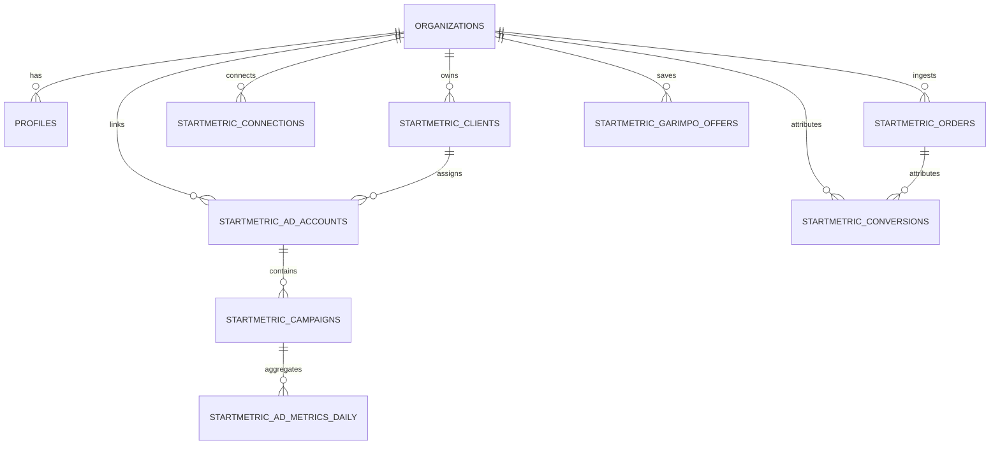

# SCHEMA.md — Start Metric Database Architecture (Prefixado `startmetric_*`)

> **Fonte Canônica de Banco de Dados do Start Metric (PostgreSQL / Supabase).**
> Todas as tabelas de domínio utilizam o prefixo obrigatório **`startmetric_`** para garantir isolamento absoluto e evitar conflitos em instâncias multi-projeto do Supabase.

---

## 🗄️ 1. Diagrama de Entidades (ERD)



---

## 🏗️ 2. Definição das Tabelas DDL com Prefixo `startmetric_`

```sql
-- Extensões necessárias
CREATE EXTENSION IF NOT EXISTS "uuid-ossp";
CREATE EXTENSION IF NOT EXISTS "pgcrypto";

-- ============================================================================
-- 1. BASE: ORGANIZAÇÕES & PERFIS (Compartilhado/Auth)
-- ============================================================================
CREATE TABLE IF NOT EXISTS organizations (
    id UUID PRIMARY KEY DEFAULT gen_random_uuid(),
    name VARCHAR(255) NOT NULL,
    slug VARCHAR(100) UNIQUE NOT NULL,
    plan VARCHAR(50) DEFAULT 'pro' CHECK (plan IN ('starter', 'pro', 'agency', 'enterprise')),
    settings JSONB DEFAULT '{}'::jsonb,
    created_at TIMESTAMPTZ DEFAULT NOW() NOT NULL,
    updated_at TIMESTAMPTZ DEFAULT NOW() NOT NULL
);

CREATE TABLE IF NOT EXISTS profiles (
    id UUID PRIMARY KEY REFERENCES auth.users(id) ON DELETE CASCADE,
    organization_id UUID NOT NULL REFERENCES organizations(id) ON DELETE CASCADE,
    full_name VARCHAR(255),
    email VARCHAR(255) NOT NULL,
    role VARCHAR(50) DEFAULT 'member' CHECK (role IN ('owner', 'admin', 'member')),
    avatar_url TEXT,
    created_at TIMESTAMPTZ DEFAULT NOW() NOT NULL,
    updated_at TIMESTAMPTZ DEFAULT NOW() NOT NULL
);

-- ============================================================================
-- 2. CONEXÕES META ADS RESILIENTES
-- ============================================================================
CREATE TABLE IF NOT EXISTS startmetric_connections (
    id UUID PRIMARY KEY DEFAULT gen_random_uuid(),
    organization_id UUID NOT NULL REFERENCES organizations(id) ON DELETE CASCADE,
    connected_by UUID REFERENCES profiles(id),
    meta_user_id TEXT NOT NULL,
    meta_user_name TEXT,
    token_kind TEXT NOT NULL CHECK (token_kind IN ('user_long', 'system_user')),
    token_encrypted TEXT NOT NULL,
    token_expires_at TIMESTAMPTZ,
    scopes TEXT[] NOT NULL DEFAULT '{}',
    status TEXT NOT NULL DEFAULT 'active' CHECK (status IN ('active','expiring','expired','revoked','error')),
    last_error_code INT,
    last_error_sub INT,
    last_checked_at TIMESTAMPTZ,
    connected_at TIMESTAMPTZ DEFAULT NOW() NOT NULL,
    updated_at TIMESTAMPTZ DEFAULT NOW() NOT NULL
);

-- ============================================================================
-- 3. CLIENTES DA AGÊNCIA (CRM)
-- ============================================================================
CREATE TABLE IF NOT EXISTS startmetric_clients (
    id UUID PRIMARY KEY DEFAULT gen_random_uuid(),
    organization_id UUID NOT NULL REFERENCES organizations(id) ON DELETE CASCADE,
    name VARCHAR(255) NOT NULL,
    niche VARCHAR(100) NOT NULL,
    whatsapp_number VARCHAR(30),
    monthly_budget NUMERIC(12,2) DEFAULT 0.00,
    target_cpa NUMERIC(10,2) DEFAULT 0.00,
    target_roas NUMERIC(6,2) DEFAULT 0.00,
    status VARCHAR(30) DEFAULT 'active' CHECK (status IN ('active', 'paused', 'churned')),
    notes TEXT,
    created_at TIMESTAMPTZ DEFAULT NOW() NOT NULL,
    updated_at TIMESTAMPTZ DEFAULT NOW() NOT NULL
);

-- ============================================================================
-- 4. CONTAS DE ANÚNCIOS META ADS
-- ============================================================================
CREATE TABLE IF NOT EXISTS startmetric_ad_accounts (
    id UUID PRIMARY KEY DEFAULT gen_random_uuid(),
    organization_id UUID NOT NULL REFERENCES organizations(id) ON DELETE CASCADE,
    connection_id UUID REFERENCES startmetric_connections(id) ON DELETE SET NULL,
    client_id UUID REFERENCES startmetric_clients(id) ON DELETE SET NULL,
    meta_account_id VARCHAR(100) NOT NULL UNIQUE,
    account_name VARCHAR(255) NOT NULL,
    business_id TEXT,
    business_name TEXT,
    is_personal BOOLEAN DEFAULT false,
    access_token TEXT NOT NULL,
    token_expires_at TIMESTAMPTZ,
    currency VARCHAR(10) DEFAULT 'BRL',
    timezone_name VARCHAR(100) DEFAULT 'America/Sao_Paulo',
    status VARCHAR(50) DEFAULT 'ACTIVE',
    last_synced_at TIMESTAMPTZ,
    created_at TIMESTAMPTZ DEFAULT NOW() NOT NULL
);

-- ============================================================================
-- 5. CAMPANHAS
-- ============================================================================
CREATE TABLE IF NOT EXISTS startmetric_campaigns (
    id UUID PRIMARY KEY DEFAULT gen_random_uuid(),
    organization_id UUID NOT NULL REFERENCES organizations(id) ON DELETE CASCADE,
    ad_account_id UUID NOT NULL REFERENCES startmetric_ad_accounts(id) ON DELETE CASCADE,
    meta_campaign_id VARCHAR(100) NOT NULL UNIQUE,
    name VARCHAR(255) NOT NULL,
    objective VARCHAR(100),
    status VARCHAR(50) DEFAULT 'ACTIVE',
    daily_budget NUMERIC(12,2),
    lifetime_budget NUMERIC(12,2),
    created_at TIMESTAMPTZ DEFAULT NOW() NOT NULL,
    updated_at TIMESTAMPTZ DEFAULT NOW() NOT NULL
);

-- ============================================================================
-- 6. MÉTRICAS DIÁRIAS AGREGADAS
-- ============================================================================
CREATE TABLE IF NOT EXISTS startmetric_ad_metrics_daily (
    id UUID PRIMARY KEY DEFAULT gen_random_uuid(),
    organization_id UUID NOT NULL REFERENCES organizations(id) ON DELETE CASCADE,
    ad_account_id UUID NOT NULL REFERENCES startmetric_ad_accounts(id) ON DELETE CASCADE,
    campaign_id UUID REFERENCES startmetric_campaigns(id) ON DELETE CASCADE,
    date DATE NOT NULL,
    spend NUMERIC(12,2) DEFAULT 0.00 NOT NULL,
    impressions INT DEFAULT 0 NOT NULL,
    clicks INT DEFAULT 0 NOT NULL,
    cpc NUMERIC(10,2) DEFAULT 0.00,
    cpm NUMERIC(10,2) DEFAULT 0.00,
    ctr NUMERIC(6,2) DEFAULT 0.00,
    conversions INT DEFAULT 0,
    conversion_value NUMERIC(12,2) DEFAULT 0.00,
    roas NUMERIC(8,2) DEFAULT 0.00,
    created_at TIMESTAMPTZ DEFAULT NOW() NOT NULL,
    UNIQUE (ad_account_id, campaign_id, date)
);

-- ============================================================================
-- 7. PEDIDOS & ATRIBUIÇÃO (Real Profit)
-- ============================================================================
CREATE TABLE IF NOT EXISTS startmetric_orders (
    id UUID PRIMARY KEY DEFAULT gen_random_uuid(),
    organization_id UUID NOT NULL REFERENCES organizations(id) ON DELETE CASCADE,
    external_order_id TEXT NOT NULL,
    source TEXT NOT NULL,
    status TEXT NOT NULL DEFAULT 'completed',
    total_amount NUMERIC(12,2) NOT NULL DEFAULT 0.00,
    currency VARCHAR(10) DEFAULT 'BRL',
    customer_email TEXT,
    customer_name TEXT,
    tracking_session_id TEXT,
    attribution_fbc TEXT,
    attribution_fbp TEXT,
    click_id TEXT,
    attributed_conversion_id UUID,
    created_at TIMESTAMPTZ DEFAULT NOW() NOT NULL,
    UNIQUE (organization_id, external_order_id, source)
);

CREATE TABLE IF NOT EXISTS startmetric_conversions (
    id UUID PRIMARY KEY DEFAULT gen_random_uuid(),
    organization_id UUID NOT NULL REFERENCES organizations(id) ON DELETE CASCADE,
    external_id TEXT NOT NULL UNIQUE,
    source TEXT NOT NULL,
    event_type TEXT NOT NULL DEFAULT 'purchase',
    revenue NUMERIC(12,2) NOT NULL DEFAULT 0.00,
    currency VARCHAR(10) DEFAULT 'BRL',
    customer_id TEXT,
    customer_email TEXT,
    attributed_ad_id TEXT,
    attributed_campaign_id TEXT,
    occurred_at TIMESTAMPTZ NOT NULL,
    attribution_window_days INT DEFAULT 30,
    created_at TIMESTAMPTZ DEFAULT NOW() NOT NULL
);

-- ============================================================================
-- 8. GARIMPO DE OFERTAS & ALERTAS
-- ============================================================================
CREATE TABLE IF NOT EXISTS startmetric_garimpo_offers (
    id UUID PRIMARY KEY DEFAULT gen_random_uuid(),
    organization_id UUID NOT NULL REFERENCES organizations(id) ON DELETE CASCADE,
    domain VARCHAR(255) NOT NULL,
    title VARCHAR(255) NOT NULL,
    niche VARCHAR(100),
    active_ads_count INT DEFAULT 1,
    scaling_score INT DEFAULT 50,
    estimated_monthly_spend NUMERIC(12,2),
    screenshot_url TEXT,
    first_seen_at TIMESTAMPTZ DEFAULT NOW(),
    last_seen_at TIMESTAMPTZ DEFAULT NOW(),
    created_at TIMESTAMPTZ DEFAULT NOW() NOT NULL
);

CREATE TABLE IF NOT EXISTS startmetric_alert_rules (
    id UUID PRIMARY KEY DEFAULT gen_random_uuid(),
    organization_id UUID NOT NULL REFERENCES organizations(id) ON DELETE CASCADE,
    client_id UUID REFERENCES startmetric_clients(id) ON DELETE CASCADE,
    name VARCHAR(255) NOT NULL,
    metric VARCHAR(50) NOT NULL,
    operator VARCHAR(10) NOT NULL,
    threshold NUMERIC(12,2) NOT NULL,
    action_type VARCHAR(50) DEFAULT 'whatsapp_alert',
    is_active BOOLEAN DEFAULT true,
    created_at TIMESTAMPTZ DEFAULT NOW() NOT NULL
);

-- ============================================================================
-- 9. HABILITAR ROW LEVEL SECURITY (RLS)
-- ============================================================================
ALTER TABLE startmetric_connections ENABLE ROW LEVEL SECURITY;
ALTER TABLE startmetric_clients ENABLE ROW LEVEL SECURITY;
ALTER TABLE startmetric_ad_accounts ENABLE ROW LEVEL SECURITY;
ALTER TABLE startmetric_campaigns ENABLE ROW LEVEL SECURITY;
ALTER TABLE startmetric_ad_metrics_daily ENABLE ROW LEVEL SECURITY;
ALTER TABLE startmetric_orders ENABLE ROW LEVEL SECURITY;
ALTER TABLE startmetric_conversions ENABLE ROW LEVEL SECURITY;
ALTER TABLE startmetric_garimpo_offers ENABLE ROW LEVEL SECURITY;
ALTER TABLE startmetric_alert_rules ENABLE ROW LEVEL SECURITY;
