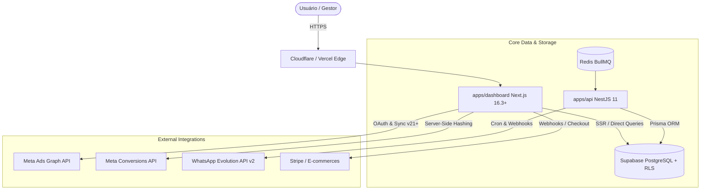

# ARCHITECTURE.md — Arquitetura Técnica do Start Metric

> **Definição Canônica:** Documenta a arquitetura de software, fluxo de dados, contratos de comunicação, segurança e limites entre módulos.

---

## 1. Visão Geral da Arquitetura

O sistema é construído sobre o padrão **Modular Monolith com Frontend Distribuído**:



---

## 2. Camadas & Responsabilidades

### 2.1. Frontend (`apps/dashboard`)
- **Framework:** Next.js 16.3.5 com App Router e React 19.
- **Renderização:** Server Components por padrão para fetching seguro + Client Components para interatividade, filtros e visualização gráfica (Recharts/Framer Motion).
- **Gerenciamento de Estado:**
  - `Zustand`: Estado de UI local (filtros de data, cliente ativo, gaveta lateral).
  - `TanStack React Query v5`: Cache de requisições de rede, revalidação e mutações assíncronas.

### 2.2. Backend & Worker (`apps/api`)
- **Framework:** NestJS 11 em TypeScript Strict.
- **ORM:** Prisma Client conectado ao pool de conexões do Supabase.
- **Filas & Cron:** BullMQ + Redis para sincronização periódica de métricas pesadas e disparos agendados de WhatsApp.

### 2.3. Banco de Dados & Segurança (`Supabase PostgreSQL`)
- **Multi-Tenancy Lógico:** Cada registro pertence a uma `organization_id` validada via Row Level Security (`RLS`).
- **Criptografia:** Tokens de acesso da Meta e credenciais de instâncias são criptografados via AES-256 (`pgcrypto`).

---

## 3. Fluxo de Dados Crítico: Cálculo de ROI e Lucro Real

```text
1. Ingestão Meta Ads:
   Gasto diário, impressões, cliques, conversões de pixel (armazenados em ad_metrics_daily).

2. Ingestão de Vendas (Pedidos Reais):
   Valor bruto, taxas de gateway, estornos, UTMs de origem (armazenados em orders / attributions).

3. Motor de Atribuição (packages/attribution):
   Cruza ad_id/campaign_id com o pedido real via modelo Last-Click.

4. Agregação (Backend Rollup):
   Lucro Bruto = Receita Atribuída - Gasto em Anúncios
   Lucro Líquido = Lucro Bruto - Taxas - Reembolsos
   ROAS Real = Receita Atribuída / Gasto em Anúncios
```

---

## 4. Estado Atual vs. Estado Alvo (Target State)

| Componente | Estado Atual (Current State) | Estado Alvo (Target State) |
|---|---|---|
| Sincronização Meta Ads | Direta via Route Handlers no Next.js | Híbrida: sob demanda no Next.js + background sync via NestJS BullMQ |
| Atribuição | Estrutura de UTMs e CAPI pronta | Ingestão contínua de pedidos multi-gateway com conciliação automática |
| WhatsApp | Conexão de instâncias e teste de envio operacionais | Scheduler autônomo com envio matinal de resumo executivo |

---

## 5. Arquitetura de Conexão Resiliente Meta Ads (Conforme `docs/meta-connection-flow.md`)

```sql
-- Tabela de Conexões por Organização
create table meta_connections (
  id                uuid primary key default gen_random_uuid(),
  org_id            uuid not null references organizations(id) on delete cascade,
  connected_by      uuid not null references profiles(id),
  meta_user_id      text not null,
  meta_user_name    text,
  token_kind        text not null check (token_kind in ('user_long', 'system_user')),
  token_encrypted   text not null,
  token_expires_at  timestamptz,
  scopes            text[] not null default '{}',
  status            text not null default 'active' check (status in ('active','expiring','expired','revoked','error')),
  last_error_code   int,
  last_error_sub    int,
  last_checked_at   timestamptz,
  connected_at      timestamptz not null default now(),
  updated_at        timestamptz not null default now()
);
```

### 5.1. Pilares da Conexão Meta
1. **Tokens Híbridos:** Suporte tanto a tokens de usuário de 60 dias (`fb_exchange_token`) via OAuth quanto a System User tokens permanentes para operação de agência.
2. **Descoberta Hierárquica:** Mapeamento de Business Managers (`/me/businesses`) com suporte a contas próprias (`owned_ad_accounts`) e de clientes (`client_ad_accounts`).
3. **Monitoramento e Alertas de Saúde:** Verificação contínua do estado dos tokens com transição automática de status (`active` ➔ `expiring` ➔ `expired`).

---

## 6. Fronteira Integração → Carteira → Operação

```text
API externa / OAuth
        │ descobre
        ▼
ad_accounts (inventário da organização, client_id pode ser null)
        │ vínculo explícito na Carteira
        ▼
cliente ativo + conta ativa + mesma organization_id
        │ autorização server-side
        ├──► Dashboard e seletores
        ├──► Relatórios
        ├──► Alertas
        └──► Agregadores financeiros
```

### 6.1. Invariantes

- Descoberta nunca equivale a autorização operacional.
- O vínculo canônico é `ad_accounts.client_id`; a plataforma permanece em `ad_accounts.platform`.
- `client_id = null` significa inventário disponível, não cliente operacional.
- Uma conta é elegível somente quando `ad_accounts.org_id = session.orgId`, possui `client_id`, está ativa e o cliente correspondente pertence à mesma organização e não está arquivado.
- Toda query operacional usa um resolvedor server-side comum ou reproduz exatamente esse predicado.
- A combinação de cliente e conta enviada pelo navegador é revalidada antes de consultar API externa ou métricas.
- “Todas as contas” significa todas as contas elegíveis do cliente selecionado.
- Arquivamento não apaga nem desvincula registros históricos; apenas os torna inelegíveis para operação.

### 6.2. Descoberta e vínculo

- Integrações podem atualizar nome, moeda, status externo e timestamps de contas descobertas.
- Integrações não atribuem cliente por nome, Business Manager ou posição na resposta.
- Vínculo, reatribuição e desvinculação são comandos explícitos da Carteira.
- Reatribuição exige intenção explícita no payload e validação de que cliente e conta pertencem à mesma organização.

### 6.3. Resposta de segurança

- Conta inexistente ou fora da organização: 404 para não revelar existência.
- Conta da organização, mas não autorizada para o cliente solicitado: 403.
- Cliente arquivado ou conta inativa: 403 nas superfícies operacionais.
